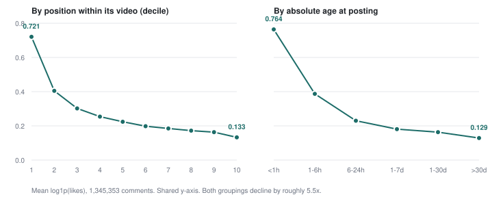
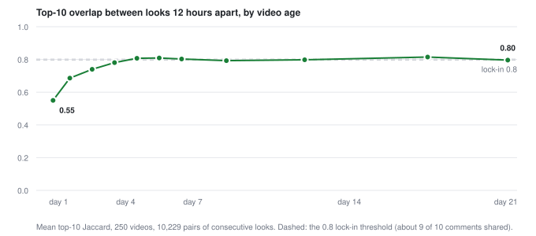
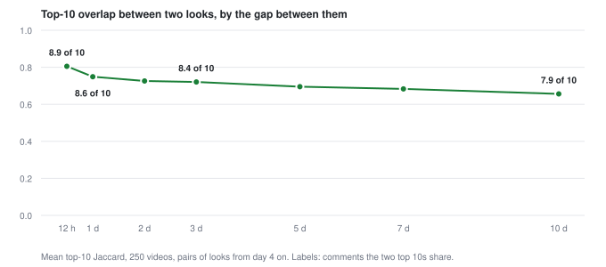

# YouTube Comment Exposure: timestamped comments and a 21-day panel of the ranking

## Abstract {-}

Public YouTube comment corpora carry like counts without the time each comment was
posted. A like count read without a timestamp mixes what a comment said with when it
arrived, and models trained on those corpora fit the head start with no way to see it.

This corpus records what was missing, now at two scales and in three languages. A bulk
corpus holds 7,152,754 top-level comments from 6,218 fully enumerated videos on 311
English, Japanese and Chinese-language channels, each with post time, fetch time and the
position YouTube's ranking gave it. A panel followed 500 new videos twice a day for 21
days and stored the ranked first page at every look: 20,454 page fetches and 1,462,289
ranked rows. The first version's 1,345,353-comment English snapshot is kept.

What orders a comment's likes replicates in all three languages: exposure accounts for
86–95% of the above-chance ordering (version 1, English: 83.5%), and text alone stays
below AUC 0.60 everywhere except Chinese on the registered encoder (0.602).

The panel, pre-registered before its second observation, shows who reaches the top and
when. 84% of the day-7 top 20 were posted within a day of upload. The page keeps moving
after that: median lock-in comes at 76 h against a predicted limit of 72, and consecutive
looks half a day apart keep about 0.80 top-10 overlap from day 4 to day 21.

The panel also tests the feedback loop version 1 stated as fact. Per hour, a comment
gains 1.85× as many likes at rank 1–10 as at rank 51 or below (CI 0.96–3.22),
short of the predicted 3×, and the median comment's own ratio is 0.90. Three of eight
pre-registered predictions hold as written.

## Changes from version 1

| version 1 | version 2 | why |
|----------|----------|--------|
| Title: "1.35M comments with post timestamps" | "timestamped comments and a 21-day panel of the ranking" | the corpus adds a bulk replication and a panel |
| "being ranked high causes likes, and likes cause being ranked high" (stated as fact) | stated as a hypothesis; the within-comment rank effect is 1.85× with a CI that spans 1 | the panel measured it (H3) |
| "Two comments of identical quality can differ by three orders of magnitude in likes on arrival time alone" | removed | neither version measures it |
| "seen by orders of magnitude more people" (abstract) | removed | neither version measures how many people saw a comment |
| 82.1% zero-like comments, presented as a property of the target | a property of the English corpus; Japanese 44.1%, Chinese 67.1% | bulk corpus (H7) |
| "Any model fit to this target is mostly fitting a zero/non-zero boundary" | limited to the English corpora | same |
| displayed rank "is caused by like count" | the ranking selects on likes | v2 does not test what the ranking reads |
| "a platform whose ranking is itself driven by likes" | "a platform that ranks comments" | same |
| 83.5% exposure share, one English corpus | 86–95% in three languages | bulk corpus (H6); v2 ladders differ, see Analysis 1 |
| Limits: "34 channels, English-dominant" | 311 channels in three languages, still a convenience sample | bulk corpus |
| Limits: "Like counts were read once" | still true of the bulk corpus; the panel reads each page twice a day for 21 days | panel |
| Availability: 633 video IDs, `results/` | both manifests, `results/v2/final/`, v2 branch | new release |

Version 2.1 (October 24, 2026) adds two things and changes nothing else: how often late
comments reach the top of older videos, at the end of "Late comments still reach the top
three", and the "No old videos" limit.

## What existing corpora leave out

The two large public YouTube comment datasets, YT-30M [@yt30m] and YTCommentVerse
[@ytcommentverse], hold roughly 32 million comments between them. Both provide `upvotes`.
Neither provides a timestamp or a reply count.

For sentiment work or language modelling that omission costs little. For anything that
treats a like count as a measure of the comment, it is disqualifying. A comment posted in
a video's first hour has more time and a less crowded page in which to collect likes than
one posted a week later. A common further claim is that YouTube's "Top comments" ranking
compounds the head start, since a high rank brings likes and likes bring a high rank.
Version 1 of this paper stated that loop as fact. The panel in version 2 tested it and
found the rank side smaller than predicted, with an interval that includes no effect
(see "A high rank buys fewer likes than predicted").

Recent work builds directly on the unadjusted target. Dong et al. [@dong2026manipulation]
fine-tuned Llama-3-8B on the top 10% most-liked comments from a Brazilian YouTube corpus
and reported roughly 3× the engagement of a model trained on random comments. Whether an
effect of that size reflects better comments or earlier ones is not answerable without
post times.

## Related work

**Predicting comment engagement.** Risch and Krestel [@risch2020topcomment] predict
upvotes and replies on Guardian comments and name the confound directly, calling it
position bias. Their control is to keep only the first ten comments under each article,
so everything in the sample was plausibly seen. That is the closest prior handling of
exposure, and it works because their platform sorts chronologically. It does not
transfer to a platform that ranks comments.

**Training on social engagement signals.** KARMA [@scott2026karma] trains a reward model
on Reddit karma and fine-tunes against it, reporting that the *best* karma-predicting
reward model produced worse downstream behaviour than a weaker one, and that factuality
degraded even when the downstream model never saw Reddit text. RLNVR
[@krishnan2025rlnvr] optimises against real Bluesky engagement and applies baseline
normalisation for exactly the reason this paper measures: raw engagement is not
comparable across posts. Both treat the confound as a nuisance to be normalised away.
The corpus here lets it be measured instead.

**Comment generation.** The task and its first large dataset come from Qin et al.
[@qin2018commenting] on Tencent News. Coppolillo et al. [@coppolillo2024engagement]
optimise a generator against engagement, with the reward supplied by a formal simulation
rather than observed data. HotComment [@hotcomment] benchmarks comment popularity across
Chinese platforms and is the nearest analogue to the evaluation audited in Analysis 2.

**Comparing within a shared context.** Tan et al. [@tan2016winning] compare
counterarguments made to the *same* opinion on ChangeMyView, holding the context fixed so
language effects are separable from who happened to reply to what. The within-video
design used here is the same move, with post time as the additional term that a
persuasion setting doesn't have to carry.

## The corpus

Three collections share one schema and one collector. The two comment counts overlap:
386 of version 1's 633 videos are also in the bulk corpus, so the counts should not be
added.

| | v1 snapshot | v2 bulk | v2 panel |
|---|---|---|---|
| videos | 633 | 6,218 enumerated (6,240 frozen) | 500 |
| channels | 34 | 311 | 205 |
| languages | English | English, Japanese, Chinese | 167 en, 167 ja, 166 zh |
| rows | 1,345,353 comments | 7,152,754 comments | 20,454 fetches, 1,462,289 ranked rows |
| collection | read once, at least 30 days after publication | read once, 2026-09-19 to 2026-10-01 | twice a day for 21 days from enrollment |

Per comment in both snapshot corpora: `comment_id`, `video_id`, `author_hash`, `text`,
`like_count`, `reply_count`, `published_at`, `fetched_at`, `age_hours`, and
`relevance_rank` (the position on the displayed top page, or null). Per video: channel,
publish time, title, category, duration, `is_short`, view count, like count, comment
count, and how many comments were collected. The bulk corpus adds `lang` and `marquee`
per video. `lang` is the channel's language as assigned when the channel list was built,
with no per-comment detection.

**Every video is enumerated completely.** `commentThreads.list` returns newest-first, so
capping pages per video would systematically drop the oldest comments, which are the
high-exposure ones any exposure analysis needs. Videos too large to finish inside the
API's 10,000-unit daily quota were excluded when the population was frozen, and those
exclusions are counted in the manifest rather than dropped silently.

The populations were frozen and hashed before collection began, so the samples could not
drift while they were being measured. Each manifest pins the exact video IDs and the
filters that selected them.

**Version 1 snapshot.** 633 videos from 34 English-language channels spanning science,
tech, gaming, commentary, music, geopolitics and cooking, published between 2025-02-13 and
2026-07-14 with 200 to 20,000 reported comments. All 633 completed.

**Version 2 bulk corpus.** Up to 25 videos per channel from the panel's channel list,
published from 2025-09-01 to before 2026-08-19 with 200 to 20,000 reported comments. The
Chinese-language channels are from Taiwan, Hong Kong and overseas communities; this is
Chinese-language YouTube, and mainland China is outside it.

| language | channels | videos | comments | median comments per video |
|---|---|---|---|---|
| English | 161 | 3,442 | 5,421,234 | 798 |
| Japanese | 80 | 1,683 | 1,125,474 | 348 |
| Chinese | 70 | 1,093 | 606,046 | 299 |
| pooled | 311 | 6,218 | 7,152,754 | |

**Version 2 panel.** Described with its pre-registration in "The panel" below. Per page
row: `video_id`, `period`, `is_repeat`, `rank`, `comment_id`, `author_hash`, `is_creator`,
`text`, `like_count`, `reply_count`, `published_at`, `fetched_at`, `comment_age_hours` and
`video_age_hours`. Separate tables hold each video's enrollment and status, its view,
like and comment totals per period, and every attempted fetch with its outcome.

### Likes are concentrated in the tail, more so in English

The version 1 snapshot:

| percentile | p50 | p75 | p90 | p95 | p99 | p99.9 | max |
|---|---|---|---|---|---|---|---|
| likes | 0 | 0 | 1 | 3 | 128 | 4,135 | 240,579 |

The same summary by language:

| corpus | comments | zero likes | at most one like | share of likes held by the top 1% |
|---|---|---|---|---|
| v1 snapshot (English) | 1,345,353 | 82.1% | 91.9% | 94.9% |
| v2 bulk, English | 5,421,234 | 78.5% | 90.1% | 92.4% |
| v2 bulk, Japanese | 1,125,474 | 44.1% | 62.2% | 60.6% |
| v2 bulk, Chinese | 606,046 | 67.1% | 80.9% | 71.1% |
| v2 bulk, pooled | 7,152,754 | 72.1% | 85.0% | 86.8% |

In the English corpora most comments get nothing, and a model fit to English like counts
is mostly fitting a zero/non-zero boundary. That is why the analyses below report AUC on
"received at least one like" alongside rank correlation. The Japanese and Chinese corpora
are less extreme, and the low Japanese share is spread across videos: the median video's
zero-like share is 43% in Japanese, 59% in Chinese and 76% in English. Japanese and
Chinese videos are also smaller, so these differences mix language with video size, and
nothing here separates the two.

### Arrival time predicts likes, and raw means hide it completely

Likes are summarised as `log1p(likes)`, the log of one plus the like count: a comment with
no likes scores 0, and a few viral comments cannot set the mean. By within-video
comment-age decile in the version 1 snapshot, earliest to latest, the mean falls
monotonically across all ten:

| decile | 1 | 2 | 3 | 4 | 5 | 6 | 7 | 8 | 9 | 10 |
|------------|---|---|---|---|---|---|---|---|---|----|
| mean log1p(likes) | 0.721 | 0.405 | 0.302 | 0.254 | 0.224 | 0.198 | 0.185 | 0.172 | 0.163 | 0.133 |

Pooling the same comments by absolute age gives the same shape, a 5.9× decline against
the deciles' 5.4×:

| age at posting | <1h | 1–6h | 6–24h | 1–7d | 1–30d | >30d |
|---|---|---|---|---|---|---|
| share of corpus | 9.4% | 18.1% | 21.6% | 26.6% | 10.4% | 13.9% |
| mean log1p(likes) | 0.764 | 0.387 | 0.230 | 0.181 | 0.163 | 0.129 |
| **mean raw likes** | **19.8** | **21.7** | **19.5** | **19.8** | **25.8** | **20.4** |

The last row is the warning. Summarised by the mean of raw like counts, the arrival
effect disappears entirely and the buckets look interchangeable. It survives in log space
because the raw mean is set by the handful of comments in each bucket that went viral,
and the top 1% of comments hold 94.9% of all likes. Zero-rate is flat at 81–83% across
every bucket for the same reason.

**Any summary of this corpus that averages raw like counts will report no effect where a
large one exists.** That applies to the aggregate statistics below, to the retrieval
estimator audited in Analysis 2, and to any reuse of the data.

The decline holds in every language of the bulk corpus (exploratory, mean `log1p(likes)`):

| age at posting | <1h | 1–6h | 6–24h | 1–7d | 7–30d | >30d |
|---|---|---|---|---|---|---|
| English | 0.846 | 0.430 | 0.269 | 0.214 | 0.192 | 0.150 |
| Japanese | 1.304 | 1.072 | 0.925 | 0.840 | 0.816 | 0.660 |
| Chinese | 1.271 | 0.736 | 0.454 | 0.340 | 0.284 | 0.211 |

Japanese comments start higher and fall less, which matches their lower zero-like share.

Comments on the displayed top page of the version 1 snapshot average 419.5 likes against
1.13 for everything else. That 373× gap is partly tautological, since the ranking selects
on likes, but it sizes how concentrated visibility is.

### Shorts are a steeper exposure regime than long-form

In the version 1 snapshot:

| format | videos | comments | decile 1 | decile 10 | spread |
|---|---|---|---|---|---|
| Shorts (≤60s) | 80 | 71,550 | 0.845 | 0.111 | **7.6×** |
| Long-form | 553 | 1,273,803 | 0.714 | 0.134 | **5.3×** |

Shorts are served through a separate feed with comments in a drawer, and the arrival
advantage there is about 40% steeper. `duration_seconds` and `is_short` are recorded per
video so format can be stratified rather than pooled. The panel predicted from this that
Shorts pages would also settle at least a day sooner, and that prediction fails (H5,
below).

### Channels differ more than any feature in the models

In the version 1 snapshot, zero-rate ranges from **52.8%** (`@Vox`) to **90.7%**
(`@Davie504`) across the 34 channels, and mean likes per comment from 3.1
(`@PBSSpaceTime`) to 33.2 (`@NileRed`). This spread is larger than any effect measured
below, which is why every split in this paper is by channel and every confidence interval
bootstraps over channels.

28.0% of version 1 comments contain a non-ASCII character, mostly emoji and some
non-Latin script.

### The best comments are shorter than the merely popular ones

| like tier | 0 | 1–9 | 10–99 | 100–999 | 1000+ |
|---|---|---|---|---|---|
| comments | 1,104,270 | 198,875 | 27,127 | 10,870 | 4,211 |
| mean characters | 114 | 135 | 161 | 171 | **147** |

Length rises with likes and then reverses at the top tier. The highest-liked comments in
the version 1 snapshot are short callbacks rather than developed observations:
*"alchemists hate this one trick"* (146,282 likes), *"This video is almost entirely
greyscale"* (60,515), *"that strained 'support local businesses' got me"* (196,467). A
linear length feature cannot represent that shape, which bounds how much the length rung
can contribute.

### The panel and its pre-registration

The snapshot corpora read each comment's likes once, so they cannot say when a comment
reached the top or whether its rank helped it get there. The panel watches the ranked
page form.

**Enrollment.** Each day the collector read the uploads playlist of every configured
channel and enrolled videos published in the previous 30 hours or so, interleaved across
languages, up to 80 a day, at most 2 per channel per day and 5 per channel in all. It
reached 500 videos (167 English, 167 Japanese, 166 Chinese) between 2026-09-19 and
2026-09-27. The channel list holds 332 hand-verified channels (166 English including
version 1's, 83 Japanese, 83 Chinese-language) with roughly 300K to 15M subscribers, chosen
so videos land in version 1's comment band.

**Observation.** Twice a day for 21 days from enrollment, each video's first
`order=relevance` page of comment threads (up to 100, with rank, likes, replies, post time
and text) and its view, like and comment totals. Analysis is in hours since upload at
fetch time. The panel first saw a video a median of 16 h after upload, so "posted within
an hour" below comes from each comment's own timestamp. 487 videos ran the full window;
13 were dropped when their comments were turned off.

**Pre-registration.** The plan, with all eight hypotheses and their thresholds, was
committed 33 minutes after the first enrollment fetch and before any video had a second
observation. Two later commits that day came after the second look, and neither changed a
threshold:

| event, 2026-09-19 | time (PDT) |
|-------|--|
| first enrollment fetch | 11:11 |
| plan committed (`V2.md`, H1 to H8 with thresholds) | 11:44 |
| first second-observation fetch | 13:00 |
| primary endpoint moved from day 14 to day 7 | 15:36 |
| analysis code committed (`panel_analysis.py`) | 16:49 |

Days 14 and 20 stay as registered secondary endpoints and are reported beside day 7.
Thirteen deviations from the plan are listed with the results in the code repository
(`V2-RESULTS.md`); the ones that bear on a number are noted where it appears.

**Inclusion.** A video counts at an endpoint if it had at least 100 top-level comments
there. Creator comments are excluded from every top-k set, since they are usually pinned.
The two marquee channels (`@MrBeast`, `@PewDiePie`) are excluded from pooled results.
Standard errors are clustered by channel. The kill gate (at least 200 videos with seven
or more observation days) passed with 482.

| endpoint | included | English | Japanese | Chinese | under 100 comments (en, ja, zh) |
|---|---|---|---|---|---|
| day 7 | 239 | 119 | 73 | 47 | 47, 83, 113 |
| day 14 | 243 | 119 | 77 | 47 | 47, 79, 113 |
| day 20 | 250 | 121 | 78 | 51 | 45, 78, 109 |

The minimum removes most Chinese videos, so Chinese panel results rest on fewer and larger
videos than the other two languages.

**Repeat fetches.** Each run re-fetched 20 pages it had just fetched. Across 1,130 repeat
pairs a median 46 seconds apart, median top-10 and top-20 Jaccard was 1.00, with 85 pairs
below 1 and a minimum of 0.25. A separate test of the API's consistency, run after the
panel closed, is reported in "The API returns the same page on a re-fetch".

## Analysis 1: what orders a comment's likes

Predict each comment's percentile rank of likes *within its own video*, which removes the
video effect from the training signal rather than asking a model to learn it. Then climb a
ladder of four models. Each rung keeps every feature of the rung above it and adds one
group, marked +:

1. **Exposure**: position in the comment timeline, log age in hours, log video views, log
   video comment count, whether the video is a Short.
2. **+ length and shape**: character and word count, contains a question mark, contains a
   shouted word.
3. **+ TF-IDF**: 200,000 unigram and bigram features.
4. **+ MiniLM**: 384-dimensional sentence embeddings [@reimers2019sbert].

Displayed rank is deliberately absent from every rung. The ranking selects on likes, so a
model given it would be predicting likes partly from likes.

Two metrics, because a target that's 82% zeros in the version 1 snapshot breaks the usual
ones. Within-video Spearman is the headline. Within-video AUC for "received at least one
like" is the hurdle's first stage, where most of the orderable variation sits and where
ties don't distort.

Splits are **by channel**, never by comment: eight held-out channels, with alpha tuned on
a separate five-channel validation split carved out of the training channels. Confidence
intervals bootstrap over channels, since transferring to a new audience is what has to
work. Five different held-out sets, and every rung uses the same estimator so the
comparison measures the features rather than the optimizer.

AUC for P(likes ≥ 1), averaged over held-out videos, version 1 snapshot:

| seed | exposure | + length | + TF-IDF | + MiniLM | Δ TF-IDF | Δ MiniLM |
|---|---|---|---|---|---|---|
| 0 | 0.626 | 0.637 | 0.652 | 0.654 | +0.0152 | +0.0167 |
| 1 | 0.653 | 0.668 | 0.685 | 0.685 | +0.0168 | +0.0169 |
| 2 | 0.645 | 0.663 | 0.672 | 0.675 | +0.0092 | +0.0121 |
| 3 | 0.645 | 0.658 | 0.668 | 0.669 | +0.0100 | +0.0104 |
| 4 | 0.644 | 0.658 | 0.668 | 0.671 | +0.0108 | +0.0134 |
| mean | 0.643 | 0.657 | 0.669 | 0.671 | **+0.0124** | **+0.0139** |

**A 384-dimensional semantic encoder buys 0.0015 AUC over a bag of words.** The standing
objection to a lexical null is that the text model was too weak, and a different
representation family lands in the same place.

### Where the line between exposure and content goes

Comment length is a property of the comment, so counting it as exposure is a choice that
needs defending rather than assuming. Both splits of the version 1 ladder, as shares of
above-chance AUC, averaged over the five channel splits:

| component | share | range across splits |
|---|---|---|
| exposure (post time, video scale) | **83.5%** | 81.7–86.1% |
| length and shape | 8.4% | 7.5–10.4% |
| lexical and semantic content | 8.2% | 6.2–10.9% |

Counting length as content puts content at **16.5%**; counting it as exposure puts it at
**8.2%**. Exposure is 83.5% under either convention, so the finding doesn't turn on where
that line goes. The headline number does, which is why both appear here.

### The absolute ordering is weak

The best model reaches AUC 0.671. That's a weak ordering, and it matters for how the
result should be read: exposure beats content by a wide margin, and both are small against
whatever else determines which comments get liked. Lakkaraju et al.
[@lakkaraju2013whatsinaname] found the same shape on Reddit resubmissions, where identical
content scored wildly differently across attempts. A large irreducible component is the
expected result here, not a defect in the models.

One result cuts against the content effect and belongs in the body rather than a footnote:
MiniLM's incremental Spearman interval fails to exclude zero on one of the five splits. The
content effect is real on average and not uniformly detectable across audiences.

### The result holds in Japanese and Chinese

The bulk corpus repeats the ladder per language with version 1's splits, alpha grid and
seeds, and adds one rung version 1 never had: text features alone, with no exposure or
length features, to test whether text predicts likes once exposure is out (H8). Exposure
share is (exposure AUC − 0.5)/(text-rung AUC − 0.5). Brackets are the minimum and maximum
across the five seeds, the same convention as version 1's range across splits.

| language | text rung | exposure share, mean [min, max] | text-only AUC | H6 (≥70%) | H8 (<0.60) |
|---|---|---|---|---|---|
| English | MiniLM (registered) | 86.4% [82.1, 91.0] | 0.588 | holds | holds |
| English | word TF-IDF | 86.4% [83.0, 90.0] | 0.588 | holds | holds |
| Japanese | MiniLM (registered) | 90.9% [86.7, 93.8] | 0.582 | holds | holds |
| Japanese | word TF-IDF | 94.7% [92.5, 97.9] | 0.565 | holds | holds |
| Japanese | character n-gram (exploratory) | 87.1% | 0.605 | | fails |
| Chinese | MiniLM (registered) | 90.0% [84.6, 95.8] | **0.602** | holds | **fails** |
| Chinese | word TF-IDF | 92.0% [87.1, 97.9] | 0.584 | holds | holds |
| Chinese | character n-gram (exploratory) | 86.6% | 0.625 | | fails |
| pooled | word TF-IDF | 90.6% [84.3, 96.8] | 0.580 | holds | holds |

| language | comments in the models | videos | channels |
|---|---|---|---|
| English | 5,421,217 | 3,425 | 161 |
| Japanese | 1,125,472 | 1,681 | 80 |
| Chinese | 606,043 | 1,090 | 70 |
| pooled | 7,152,732 | 6,196 | 311 |

The few videos missing against the corpus table could not be featurised. The exposure
rung alone reaches AUC 0.656 in English and 0.675 pooled. A pooled MiniLM rung was not
run, since it needs 7.15M embeddings in memory.

Two cautions apply. The version 2 ladders add each text rung separately, so their shares
sit close to version 1's 83.5% without being the same quantity. And both registered text
rungs are weak for Japanese and Chinese: all-MiniLM-L6-v2 is an English encoder, and
version 1's token pattern reads an unspaced CJK run as a single token. That biases H6 and
H8 toward passing. The character n-gram rung, added to check the bias, does score higher
on text alone, and on that rung text clears 0.60 in both languages.

The Chinese H8 failure is narrow. Per seed, the registered rung scores 0.624, 0.609,
0.573, 0.600 and 0.606.

## Analysis 2: auditing a retrieval-based engagement estimator

### This tests a reimplementation

Dong et al. [@dong2026manipulation] score a generated comment by embedding it, retrieving
its K nearest neighbours from a reference corpus, and averaging their like counts.
Everything below tests **a reimplementation of that metric on the version 1 snapshot**: a
different encoder (all-MiniLM-L6-v2), a different reference corpus, English rather than
Portuguese, and no fine-tuned generator.

The claims are about the metric as a class, not about their number. I cannot say what
produced their 3×, and two attempts to explain it failed. What the corpus does support is
checking whether a metric built this way passes validity tests any engagement estimator
should pass.

### It barely tracks the thing it estimates

The estimator's Spearman against real like outcomes is **0.050 within video**, 0.060
pooled. The exposure-only model scores 0.19 on the same comments. An estimator of
engagement orders real comments about four times worse than a model that knows nothing
except when a comment was posted and how big the video is.

### The ratio reverses with the summary statistic

One hypothesis was that the metric is satisfiable by resemblance: train on top-liked text,
land near top-liked text, score high whether or not a human would have liked the output.
Using real held-out comments as stand-ins for two models, top decile against random, the
estimator returns ratios of 0.88 to 1.21 across K ∈ {1, 5, 20} under both absolute and
within-video selection. One ratio below 1 says the measurement is noise-dominated.
Selecting top-liked text does not reproduce a 3× ratio, and that prediction is withdrawn.

A second version tested whether *generated* text behaves differently: 960 Haiku 4.5
generations over 120 held-out videos, half few-shot conditioned on real top-liked comments
from training channels, half unconditioned. Few-shot conditioning approximates fine-tuning
on the top-liked decile cheaply; it pushes the same direction and isn't the same thing.
Conditioning shows no reliable effect, so the resemblance hypothesis stays withdrawn.

What that run exposed is that the statistic itself won't hold still.

| K | ratio of means | ratio of medians | 95% CI on the mean ratio |
|---|---|---|---|
| 1 | 0.25 | 0.00 | [0.06, 2.69] |
| 5 | 0.31 | 2.00 | [0.17, 0.61] |
| 20 | 0.73 | 1.87 | [0.43, 1.19] |

At K=5 the mean says conditioning made the score three times worse, with an interval
excluding 1.0, while the median on the same 480 samples says twice better. Like counts are
heavy-tailed, so a mean over nearest-neighbour like counts tracks whichever generations
landed beside a viral comment. Across three runs of this experiment the same ratio came
out 138, then 0.09, then 0.25 by mean and 2.00 by median.

A metric whose direction flips with the choice of summary statistic, at n=480, can't carry
a 3× claim. That holds regardless of what produced any particular published number.

### Generated comments occupy a narrower space than real ones

Mean pairwise cosine within each set: unconditioned generations 0.152, conditioned
generations 0.202, real held-out comments 0.062. Generated text sits in a region roughly
three times narrower than real comments do, stable across all three runs because it
averages over thousands of pairs instead of a few dozen heavy-tailed draws.

Any nearest-neighbour metric evaluated on generated text is therefore sampling a much
smaller neighbourhood of the reference corpus than the same metric applied to real text,
which is worth knowing before using one to compare generators.

## Analysis 3: how the top page forms

Every result in this section comes from the panel. Lock-in for a video is the first
observation whose top 10 has Jaccard overlap of at least 0.8 with the endpoint page's
top 10. Each endpoint's page is the first observation at or after it, a median 6.9 h
late at day 7.

### Most final top comments were posted in the first day

Share of each endpoint page's top 20 posted within 1, 6 and 24 hours of upload, with 95%
intervals for the pooled rows:

| endpoint | language | ≤1 h | ≤6 h | ≤24 h |
|---|---|---|---|---|
| day 7 | pooled | 34.4% [31.0, 37.5] | 65.4% [61.7, 68.8] | 84.4% [81.9, 86.8] |
| day 7 | English | 36.1% | 64.8% | 84.4% |
| day 7 | Japanese | 37.9% | 69.5% | 85.1% |
| day 7 | Chinese | 24.5% | 60.9% | 83.4% |
| day 14 | pooled | 34.6% [31.3, 37.8] | 65.4% [61.9, 68.5] | 82.9% [80.1, 85.4] |
| day 14 | English | 37.2% | 65.5% | 83.1% |
| day 14 | Japanese | 37.1% | 69.4% | 84.5% |
| day 14 | Chinese | 24.0% | 58.7% | 79.8% |
| day 20 | pooled | 32.9% [29.6, 36.3] | 63.0% [59.4, 66.4] | 81.6% [78.7, 84.2] |
| day 20 | English | 34.9% | 62.8% | 81.4% |
| day 20 | Japanese | 36.4% | 67.7% | 83.4% |
| day 20 | Chinese | 22.8% | 56.2% | 79.3% |

The 24-hour share barely moves between endpoints, so the comments that hold the top late
in a video's life were mostly posted on its first day. Chinese pages fill more slowly in
the first hour and catch up by the end of the day. The median top-20 comment was posted
2.4 h after upload at day 7 (n = 4,780 slots) and 2.74 h at day 20 (n = 5,000).

Who holds the top is settled by arrival; when the page stops changing is a separate
question, and the next two sections answer it.

### The page keeps moving after the predicted lock-in

| endpoint | videos | median lock-in, h [95% CI] | interquartile range, h | locked by 72 h | locked at first look | never before endpoint |
|---|---|---|---|---|---|---|
| day 7 | 239 | 76.0 [66.8, 93.4] | 40.0 to 141.9 | 47.7% | 30 | 27 |
| day 14 | 243 | 146.0 [117.0, 176.0] | 57.0 to 290.5 | 30.9% | 25 | 30 |
| day 20 | 250 | 137.8 [112.0, 176.0] | 54.7 to 332.0 | 34.0% | 19 | 19 |

The median rose from day 7 to day 14 and then stopped rising, with overlapping intervals
at days 14 and 20, so it settles near six days. A stricter definition, the first
observation after which the overlap never again falls below 0.8, gives medians of 150.9,
321.1 and 464.0 h at the three endpoints: by that reading the median page settles only
in the last day before each endpoint.

By language and format (medians, hours):

| endpoint | English | Japanese | Chinese | Shorts | long-form | long-form minus Shorts [95% CI] |
|---|---|---|---|---|---|---|
| day 7 | 82.0 | 69.2 | 79.5 | 63.9 (40 videos) | 79.5 (199) | 15.6 [−24.5, 39.2] |
| day 14 | 146.0 | 165.1 | 129.0 | 122.8 (41) | 147.5 (202) | 24.7 [−46.0, 117.0] |
| day 20 | 116.3 | 188.5 | 150.8 | 97.0 (43) | 140.2 (207) | 43.2 [−146.0, 96.0] |

Shorts settle sooner on every point estimate, and every interval includes zero. Genre
spreads lock-in further than language or format does (day 7, genres with at least 14
videos):

| genre | videos | median lock-in, h |
|---|---|---|
| entertainment | 58 | 55.8 |
| gaming | 35 | 63.0 |
| music | 14 | 69.0 |
| commentary | 29 | 76.0 |
| food | 21 | 79.5 |
| tech | 17 | 85.4 |
| science | 21 | 104.0 |
| news | 20 | 120.7 |

How much of each endpoint page an earlier page already holds (mean top-20 Jaccard
against the endpoint page, by the earlier page's age):

| earlier page's age | 0–6 h | 24–48 h | 72–96 h | 144–168 h | 240–336 h | 336–504 h |
|---|---|---|---|---|---|---|
| vs day 7 | 0.236 | 0.562 | 0.676 | 0.804 | | |
| vs day 14 | 0.244 | 0.521 | 0.607 | 0.663 | 0.741 | |
| vs day 20 | 0.210 | 0.507 | 0.589 | 0.645 | 0.711 | 0.774 |

The day-7 page shares 0.645 of its top 20 with the day-20 page.

### Consecutive pages keep differing; the drift accumulates slowly

From day 4 to day 21 consecutive pages keep a mean top-10 overlap of about 0.80, and
about a third of consecutive pairs fall below the 0.8 lock-in threshold for as long as
the panel watched. The movement does accumulate, though much more slowly than one step
suggests:

| time between looks | 12 h | 24 h | 48 h | 72 h | 120 h | 168 h | 240 h |
|---|---|---|---|---|---|---|---|
| mean top-10 Jaccard | 0.805 | 0.749 | 0.726 | 0.721 | 0.695 | 0.683 | 0.656 |

Most single-step movement is swapping at the edge of the top 10. Of the 8,947 comments
that leave the top 10 in one 12-hour step, the median lands at rank 13, 30% are back at
the next look and 46% within two.

### Late comments still reach the top three

Comments that first enter the top 20 at 72 h or later number a median of 6 per video at
day 7, 11 at day 14 and 13 at day 20, and every video included at day 20 has at least one.
Most of them are late risers: at day 7, 27% were also posted after 72 h.

The top three, on 482 closed videos with creator comments excluded (exploratory):

| posted this long or more after the video | final top-3 slots | share of 1,338 slots | videos |
|---|---|---|---|
| 24 h | 207 | 15.5% | 150 |
| 48 h | 122 | 9.1% | 104 |
| 7 days | 39 | 2.9% | 34 |

Of the 122 slots won by comments posted two or more days in, 45 went to comments first
seen below rank 10 (median first-seen rank 6).

The panel stops at day 21; the snapshot corpora reach further. Each stored top page was
read once, at whatever age its video had then, so this is a cross-section, not a panel
(exploratory). As videos age, comments posted 30 or more days after upload take a larger
share of top-three slots, and at every age they hold about a third of their share of all
comments:

| video age when read | videos | comments posted ≥30 days in | their share of top-3 slots | ratio |
|---|---|---|---|---|
| under 3 months | 1,044 | 4.3% | 1.3% | 0.30 |
| 3–6 months | 1,590 | 8.0% | 1.8% | 0.22 |
| 6–12 months | 3,213 | 12.6% | 3.8% | 0.30 |
| over 12 months | 343 | 14.2% | 5.1% | 0.36 |

Version 1's oldest videos agree: on 230 past a year old (median 447 days), comments posted
30 or more days in hold 6.2% of top-three slots against 20.1% of comments (ratio 0.31), and
143 of the 230 have one in their top 20. The largest held rank 1 with 60,515 likes, posted
36 days after its video. The ratio stays between 0.22 and 0.36 at every age, so the head
start does not compound as a video ages: late comments win more of the top because more of
the comments are late. Neither corpus has a video older than about 18 months, so videos
years old, or ones whose traffic returns long after upload, are untested.

### A high rank buys fewer likes than predicted

H3 measures the loop within comment: the same comment's like gain per hour in periods it
sat at rank 1–10 against periods at rank 51 or below, which holds the comment's content
fixed and varies only its position. Only comments that moved between the two bands count.
What moves a comment is not random, so the estimate stays observational.

| quantity | value |
|-------|----|
| comments seen at both rank ≤10 and rank ≥51 | 2,484, on 163 channels |
| mean likes per hour at rank ≤10 | 0.54 |
| mean likes per hour at rank ≥51 | 0.29 |
| ratio per hour [95% CI] | **1.85** [0.96, 3.22] |
| ratio per period (exploratory) | 1.83 |
| median of per-comment ratios (exploratory) | 0.90 |
| comments with zero or negative gain at rank ≥51 | 1,296 |
| ratio per hour on the 10-09 snapshot [95% CI] | 1.89 [1.04, 3.48] |

The prediction was at least 3×. The pooled ratio is under 2×, its interval now includes
1, and the median comment gains slightly less at the top than lower down. A minority of
comments carries the pooled 1.85. An earlier snapshot of the same panel gave an interval
that just excluded 1; the final one does not.

### The API returns the same page on a re-fetch

The panel's repeat fetches came 46 seconds apart, and the API could have served them
from a cache, so a floor of 1.00 could hide noise that would make part of the measured
drift an artifact. A test added on 2026-10-22 re-fetched 250 closed panel videos (26.5 to
34.2 days old, median 31.3) in a standard and a cache-busted form, back to back and again
after 15, 60 and 120 minutes, for 1,250 API units.

| comparison | videos | top-10 Jaccard | top-20 Jaccard |
|------|--|-----|-----|
| back to back, all three pairings | 250 | 1.00 in every pair | 1.00 in every pair |
| 15 minutes apart, either form | 84 | 1.00 in every pair | 1.00 in every pair |
| 60 minutes apart | 83 | 1.00 | 0.9977 (2 videos below 1) |
| 120 minutes apart | 83 | 0.9956 (2 below 1) | 0.9944 (4 below 1) |

At 15 minutes the response's etag differed in 96–98% of pairs while the ranking was
identical, so the cache was not serving stale pages. The standard and cache-busted arms
matched at every gap. Against this floor the panel's movement is almost all real: the
floor explains 0.008 of the 12-hour top-10 movement (observed overlap 0.805) and 0.007 of
the day-7 to day-20 top-20 movement (observed 0.645).

The ranking was still moving after the panel closed: the same videos' last panel page
shares 0.75 of its top 10 with their first re-fetch.

Two gaps remain. The test ran on month-old videos after the panel closed, and a young
video's ranking, the period the panel's main results cover, may be noisier between
calls. And every number here describes the API's anonymous ranking. On day 3 a logged-out
browser saw top-10 pages that shared 10, 5, 7, 8 and 8 comments with the API's page on
five videos, against 12-hour API drift of 7 to 10 on the same videos. A signed-in viewer's
page may differ again.

## The eight predictions

H1 to H5 were registered for the panel at day 7, and H6 to H8 for the bulk corpus.

| | prediction | result | verdict |
|-|--------|--------|-------|
| H1 | median lock-in ≤72 h, with the 0.8 threshold clear of the repeat-fetch floor | 76.0 h [66.8, 93.4]; floor 1.00; 146.0 h at day 14, 137.8 h at day 20 | fails at every endpoint, inside its kill line of 7 days |
| H2 | ≥70% of the day-7 top 20 posted within 24 h, and ≥30% within 1 h | 84.4% and 34.4%; 81.6% and 32.9% at day 20 | holds at every endpoint |
| H3 | a period at rank 1–10 gains ≥3× the likes of one at rank 51–100, within comment | 1.85× [0.96, 3.22] | fails |
| H4 | H1 and H2 per language within 1 day and 10 points of pooled (checked on lock-in and the 24 h share) | day 7: lock-in 69.2 to 82.0 h, 24 h share 83.4% to 85.1% | holds at days 7 and 14; fails for Japanese at day 20 (188.5 h) |
| H5 | Shorts lock in at least 1 day sooner than long-form | 15.6 h sooner [−24.5, 39.2] | fails; 24.7 and 43.2 h at days 14 and 20, intervals spanning zero |
| H6 | exposure share ≥70% in each language | 86.4%, 90.9%, 90.0% (registered rung) | holds |
| H7 | zero-like share within 75–90% in each language | 78.5%, 44.1%, 67.1% | holds for English only |
| H8 | text-only AUC below 0.60 in each language | 0.588, 0.582, 0.602 | fails for Chinese |

The arrival result (H2) held, the timing results (H1, H5) failed, and the feedback loop
(H3) came out smaller than predicted. Exposure dominates in every language (H6), while
the like distribution itself differs by language (H7).

## Limits

**Coverage.** Every channel came from a hand-built list of established creators with
roughly 300K to 15M subscribers and active comment sections, in three languages, on one
platform. It is a stratified convenience sample and generalises to channels like these,
not to YouTube, to small channels, to corporate media, or to anything with comments off.
Videos above 20,000 comments are absent from both snapshot corpora, and exposure effects
are largest there.

**No old videos.** Every video in both snapshot corpora was published between February
2025 and August 2026, so none was older than about 18 months when read. The exposure
features record a comment's age and the video's current view count, not when those views
arrived. A video whose traffic comes back years after upload gives a late comment an
audience the model scores as small, and nothing here measures such videos.

**Language is confounded with video size.** Japanese and Chinese videos in the bulk
corpus are less than half the median English size, and no analysis here controls for it.
The 100-comment panel minimum then removes most Chinese videos.

**Overlap between corpora.** 386 of version 1's 633 videos are also in the bulk corpus,
read again with more settling time. The English replication is therefore partly a re-read
of version 1's videos and partly new ones.

**One read per comment in the snapshot corpora.** `fetched_at` records when, and comments
read early in a multi-day run had less settling time than those read late. Only the panel
observes change, and only on the first page of up to 100 comments: it sees who is on the
page and nothing below it.

**Pinned and hearted status are invisible.** The API exposes neither, so a comment the
creator pinned or hearted looks like any other ranked comment, apart from the creator's
own comments, which are excluded.

**Pseudonymity, not anonymity.** Author channel IDs are salted hashes, which blocks
linking authors across datasets. The two releases used different salts, so the same
author has different hashes in each. Comment text is public and searchable, so
re-identification from the text remains possible.

**The analyses are probes, not ceilings.** The embedding rung is a linear probe on frozen
vectors; it bounds what's linearly decodable from a general-purpose encoder, not what a
fine-tuned model could extract. The registered text rungs are weak for Japanese and
Chinese. Author history isn't a feature yet, and adding it needs a time cut to avoid
leaking the same corpus's likes into the prediction.

**Nothing here is validated against human judgement.** Every claim, including the claim
that like counts are a poor quality target, is measured against like counts. A study
arguing that a metric fails to capture what people find good, using only that metric,
inherits the limitation it describes. Settling it needs human ratings with exposure held
fixed, which this corpus makes possible and does not contain.

## Availability

The corpus is at
[huggingface.co/datasets/brianhliou/youtube-comment-exposure](https://huggingface.co/datasets/brianhliou/youtube-comment-exposure).
Version 1's files sit at the repository root and version 2's under `v2/`, with a manifest
giving row counts, field lists and a SHA-256 for every file.

The collector, the frozen population manifests, the pre-registered plan with its dated
amendments, the analysis code, and this paper's source are at
[github.com/brianhliou/youtube-comment-exposure](https://github.com/brianhliou/youtube-comment-exposure)
under MIT, on the `v2` branch under `studies/comments/`. `V2-RESULTS.md` there lists every
deviation from the plan, and `results/v2/final/` holds the JSON each version 2 table above
was read from.

Comment text belongs to the people who wrote it. The collection, schema, and derived
fields are released under CC BY 4.0, following the precedent set by YTCommentVerse
[@ytcommentverse]. YouTube's API terms restrict storage and redistribution of API data,
and this release occupies the same grey area as every public YouTube comment corpus.
Takedown requests for specific comments will be honored.

## References
